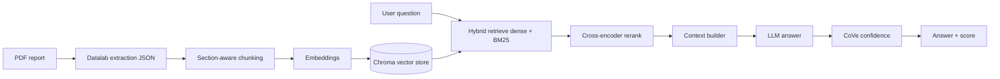

# Metadata Enrichment — RAG Pipeline & Explorer

## Demo

<video src="Sorted-broo-final.mp4" controls width="100%"></video>

[Download demo video](Sorted-broo-final.mp4)

## Presentation

[Metadata Enrichment SLB (PowerPoint)](Metadata_Enrichment_SLB.pptx.pptx)

---

An end-to-end **Retrieval-Augmented Generation (RAG)** system that reads oil & gas
well-completion reports (PDF → JSON) and answers structured metadata questions
about each well — facility name, coordinates, spud/completion dates, operator,
basin, field, formation markers, and more.

It ships as two things:

| Part | What it is | Where |
|---|---|---|
| **`rag/`** | The RAG pipeline + all evaluation, benchmarking, and tooling (a Python package) | [`rag/`](rag/) |
| **`webapp/`** | A FastAPI + React "RAG Explorer" UI for interactive exploration | [`webapp/`](webapp/) |

> New here? Read this file top-to-bottom once, run the [Quick start](#5-quick-start-5-minutes),
> then dive into the [detailed docs](docs/) when you need depth.

---

## Table of contents

1. [What it does](#1-what-it-does)
2. [How it works (at a glance)](#2-how-it-works-at-a-glance)
3. [Repository layout](#3-repository-layout)
4. [Setup (step by step)](#4-setup-step-by-step)
5. [Quick start (5 minutes)](#5-quick-start-5-minutes)
6. [Data layout](#6-data-layout)
7. [Command reference](#7-command-reference)
8. [Web app (RAG Explorer)](#8-web-app-rag-explorer)
9. [Configuration](#9-configuration)
10. [Troubleshooting](#10-troubleshooting)
11. [Full command cheat-sheet](#11-full-command-cheat-sheet)
12. [Documentation](#12-documentation)

---

## 1. What it does

- **Extracts** structured text from PDF completion reports (via Datalab → JSON).
- **Chunks** each document hierarchically (section-aware) and **embeds** the chunks
  into a persistent [Chroma](https://www.trychroma.com/) vector store (embed-once).
- **Retrieves** relevant chunks with hybrid dense + BM25 search, then **reranks**
  them with a cross-encoder.
- **Answers** each metadata question with an LLM, optionally escalating to parent
  sections (hierarchical context) and running a Chain-of-Verification confidence pass.
- **Evaluates** answers against ground truth (LLM judge + token match), and provides
  a full **benchmarking suite** (embedding models, reranker, generator LLMs,
  Matryoshka embedding dimensions) plus a **retrieval gold-set** MTEB-style scorer.

---

## 2. How it works (at a glance)



For a deeper explanation of every stage, see [`docs/pipeline.md`](docs/pipeline.md)
and [`docs/architecture.md`](docs/architecture.md).

---

## 3. Repository layout

```
Metadata-Enrichment/
├── Sorted-broo-final.mp4              # demo walkthrough video
├── Metadata_Enrichment_SLB.pptx.pptx  # project overview presentation
├── rag/                     # RAG pipeline + tooling (one Python package)
│   ├── main.py              # entry point: build / query / interactive / evaluate
│   ├── config.py            # ALL hyperparameters and component toggles
│   ├── requirements.txt     # pipeline dependencies
│   ├── common/              # schema, io, tokens, ssl patch, sauth_token (auth)
│   ├── indexing/            # loader → merge → chunk → embed → vector store
│   ├── inference/           # retrieve → rerank → context → LLM → verify (+ batch_runner)
│   ├── evaluation/          # core.py (metrics driver), batch.py, retrieval_metrics.py
│   ├── query_generation/    # schema-driven query synthesis
│   ├── scripts/             # CLI drivers  →  python -m rag.scripts.<name>
│   ├── benchmarking/        # embedding / reranker / LLM / Matryoshka benchmarks
│   ├── reports/             # docx / markdown report generators
│   └── data_prep/           # download (model), linking (PDF↔JSON), starter
├── webapp/
│   ├── backend/             # FastAPI app wrapping the rag package
│   └── frontend/            # React + Vite UI
├── docs/                    # detailed project documentation
└── <data dirs>              # datalab-output/, matched_json/, chroma_store/, ...
```

Everything is run **from the repository root** as a module, e.g.
`python -m rag.scripts.build_retrieval_goldset`.

---

## 4. Setup (step by step)

### 4.1 Prerequisites

| Tool | Version | Needed for |
|---|---|---|
| Python | 3.10+ (3.12 tested) | the whole pipeline |
| Node.js | 18+ | the web app frontend only |
| git | any | cloning |

### 4.2 Get the code

```bash
git clone <your-repo-url> Metadata-Enrichment
cd Metadata-Enrichment
```

### 4.3 Create and activate a virtual environment

Windows (PowerShell):

```powershell
python -m venv .venv
.\.venv\Scripts\Activate.ps1
```

macOS / Linux (bash):

```bash
python -m venv .venv
source .venv/bin/activate
```

### 4.4 Install the pipeline dependencies

```bash
pip install --upgrade pip
pip install -r rag/requirements.txt
```

> `faiss-cpu`, `chromadb`, and `rank-bm25` are required. The dense embedding /
> reranker deps (`torch`, `transformers`, `sentence-transformers`) are optional —
> without them the system falls back to TF-IDF dense retrieval.

### 4.5 (Optional) install the web app dependencies

```bash
pip install -r webapp/backend/requirements.txt      # FastAPI + uvicorn
cd webapp/frontend && npm install && cd ../..        # React + Vite
```

### 4.6 (Optional) download a local Jina v3 embedding snapshot

Avoids hitting HuggingFace at runtime (only needed if you use `--embedding-model jina`):

```bash
python -m rag.data_prep.download
```

### 4.7 Environment variables

Defaults live in [`rag/config.py`](rag/config.py). Override the LLM / deployment
settings via environment variables (create a `.env` or export them):

| Variable | Purpose | Default |
|---|---|---|
| `LLM_MODEL` | Generation + judge LLM | `gpt-5-mini` |
| `LLM_BASE_URL` | Internal model-ops API base URL | SLB deployment URL |
| `SLB_PARTITION_ID` | Deployment partition ID | `sandbox-...` |
| `JINA_API_URL` | Hosted Jina v3 embedding server | Cloud Run URL |

Authentication for the internal SLB stack is handled by
`rag/common/sauth_token.py` (a local, git-ignored helper).

### 4.8 Verify the install

```bash
python -m rag.main --help
```

If that prints the command help without an import error, you're ready.

---

## 5. Quick start (5 minutes)

Run everything from the repo root. Replace `PR2610` with any doc id present in
`datalab-output/`.

```bash
# 1) Build the vector index from one extraction JSON (embed-once into Chroma)
python -m rag.main build --input "datalab-output/datalab-output-PR2610.pdf.json"

# 2) Ask one question
python -m rag.main query --query "What is the well name?"

# 3) Explore interactively (REPL)
python -m rag.main interactive

# 4) Full per-step evaluation on one document (retrieval + generation + judge)
python -m rag.main evaluate \
  --input "datalab-output/datalab-output-PR2610.pdf.json" \
  --ground-truth "matched_json/PR2610.json" \
  --queries queries.txt
```

Prefer a UI? Jump to [Web app](#8-web-app-rag-explorer).

---

## 6. Data layout

These folders hold **data, not code** — they are not part of the two code roots.

| Path | Description |
|---|---|
| `datalab-output/` | Datalab extraction JSON files (`datalab-output-PR2610.pdf.json`, …) |
| `matched_json/` | OSDU ground-truth JSON per document (`PR2610.json`, …) |
| `enriched_ground_truth/` | Human-verified ground truth (only the attributes a reviewer confirmed) |
| `pdfs/` | Source PDFs (served by the web app for highlighting) |
| `queries.txt` | Evaluation queries, grouped by label (facility name, lat+long, openv ID, spud date, country, operator, basin, field, markers, completion date, vertical measurements) |
| `chroma_store/` | Persistent Chroma vector store (one collection per embedding model × chunk strategy) |
| `output_table/` | Evaluation summaries, gold sets, charts, and study reports |
| `jina-v3/` | Optional local Jina v3 model snapshot |

Doc IDs are derived from filenames: `datalab-output-PR2610.pdf.json` → `PR2610`.
See [`docs/data.md`](docs/data.md) for file formats.

---

## 7. Command reference

> All commands run from the **repository root**. Every tool accepts `--help`.

### 7.1 Core pipeline — `rag.main`

| Command | Purpose |
|---|---|
| `python -m rag.main build --input <json>` | Index one extraction JSON into Chroma/FAISS |
| `python -m rag.main query --query "..."` | Ask one question against the built store |
| `python -m rag.main interactive` | Interactive REPL |
| `python -m rag.main evaluate --input <json> --ground-truth <json>` | Per-step metrics on one doc |

Shared hyperparameter overrides (apply to every `rag.main` command):

```bash
python -m rag.main query --query "..." \
  --embedding-model openai \
  --retrieval-mode hybrid --hybrid-alpha 0.85 \
  --use-reranker --reranker-model cross-encoder/ms-marco-MiniLM-L-6-v2 \
  --context-mode hierarchical --hierarchical-max-depth 5 \
  --chunk-size 800 --overlap 200 \
  --top-k 25 --rerank-top-k 10 \
  --llm-model gpt-5-mini
```

| Flag | Meaning |
|---|---|
| `--embedding-model` | `openai` \| `jina` \| `jina-api` \| `minilm` \| `tfidf` \| any HF id |
| `--chunk-size`, `--overlap` | Sliding-window chunk size / overlap (chars) |
| `--naive` | Chunk raw JSON blocks without section merge (A/B baseline) |
| `--no-cross-page-merge` | Disable cross-page section merge |
| `--retrieval-mode`, `--hybrid-alpha` | `dense`\|`hybrid`; α=0 pure BM25 … 1 pure dense |
| `--top-k`, `--rerank-top-k` | Candidates retrieved / kept after rerank |
| `--use-reranker` / `--no-reranker` | Toggle cross-encoder reranking |
| `--context-mode` | `chunk` \| `full_page` \| `hierarchical` |
| `--hierarchical-max-depth` | Ancestor levels to climb in hierarchical mode |
| `--save-pages` | Save the exact context sent to the LLM |
| `--llm-model` | Override the generation/judge LLM |

`evaluate`-only flags: `--queries`, `--metrics-output`, `--cache-root`,
`--no-cache`, `--rebuild`, `--no-judge`.

Full flag documentation: [`docs/cli-reference.md`](docs/cli-reference.md).

### 7.2 Batch evaluation (whole corpus)

**Recommended — single-process batch runner** (loads embedder, reranker, and LLM
once, then runs the corpus with bounded parallelism):

```bash
# Baseline end-to-end run (defaults from rag/config.py)
python rag/inference/batch_runner.py

# Hierarchical context, limit process pool (recommended on Windows / large JSONs)
python rag/inference/batch_runner.py --context-mode hierarchical --load-max-workers 1

# Smoke test on one document
python rag/inference/batch_runner.py --only PR2610

# Build Chroma index only (skip inference)
python rag/inference/batch_runner.py --build-only

# Skip the LLM judge (token match only)
python rag/inference/batch_runner.py --no-judge
```

Output: `output_table/batch_runner_summary.json`

**Legacy — subprocess-per-doc driver:**

```bash
python -m rag.evaluation.batch                       # whole corpus
python -m rag.evaluation.batch --only PR2610 PR2611
python -m rag.evaluation.batch --reuse-existing      # skip docs with cached metrics
python -m rag.evaluation.batch --rebuild --no-judge
```

Output: per-doc JSON in `output_table/batch/`, combined `output_table/batch_summary.json`.

### 7.3 Retrieval gold set + retrieval metrics

```bash
# 1) Build the graded gold set (correct=2 / distractor=1 / omitted); resumable
python -m rag.scripts.build_retrieval_goldset --num-docs 40 --restart --concurrency 12 --batch-size 8

# 2) Score retrieval configs (dense + hybrid α=0.5/0.7/0.85 × inject/no-inject)
python -m rag.scripts.evaluate_retrieval
python -m rag.scripts.evaluate_retrieval --rerank        # add cross-encoder reranking
```

Outputs: `output_table/retrieval_goldset.json`, `output_table/retrieval_metrics.json`.

### 7.4 Matryoshka embedding-dimension study

```bash
python -m rag.scripts.build_retrieval_goldset --num-docs 40 --restart --concurrency 12 --batch-size 8
python -m rag.scripts.run_matryoshka_study                       # full 10-config study (resumable)
python -m rag.scripts.run_matryoshka_study --only PR2610         # smoke test
python -m rag.scripts.run_matryoshka_study --models text-embedding-3-large --dims 256 512 1024
python -m rag.scripts.analyze_matryoshka_study                   # analyze summaries
python -m rag.reports.md_to_docx output_table/matryoshka/analysis_report.md
```

Outputs under `output_table/matryoshka/`.

### 7.5 Chunking hyperparameter tuning

```bash
python -m rag.scripts.tune_chunking --chunk-sizes 400 800 1200 --overlaps 0 100 200
python -m rag.scripts.aggregate_tuning_results
```

Output: `output_table/tuning_best_10files.json`.

### 7.6 Baselines & live validation

```bash
# RAG vs naive exhaustive page scan
python -m rag.scripts.compare_rag_vs_exhaustive \
  --input "datalab-output/datalab-output-PR2610.pdf.json" \
  --ground-truth "matched_json/PR2610.json"

# Naive exhaustive baseline only
python -m rag.scripts.exhaustive_search \
  --input "datalab-output/datalab-output-PR2610.pdf.json" \
  --ground-truth "matched_json/PR2610.json" --queries queries.txt

# Validate the live Chroma query path (same code path as rag.main query)
python -m rag.scripts.validate_query --ground-truth matched_json/PR2610.json --show-chunks
```

### 7.7 Benchmarking suite

Four benchmarks (embedding models, Matryoshka dims, reranker, generator LLMs),
each with an enriched-ground-truth variant:

```bash
python -m rag.benchmarking.benchmark_embeddings
python -m rag.benchmarking.benchmark_matryoshka
python -m rag.benchmarking.benchmark_reranker
python -m rag.benchmarking.benchmark_llms

# Enriched-ground-truth variants
python -m rag.benchmarking.benchmark_enriched            # full suite
python -m rag.benchmarking.benchmark_enriched_embeddings
```

Full details and flags: [`rag/benchmarking/README.md`](rag/benchmarking/README.md)
and [`docs/benchmarking.md`](docs/benchmarking.md).

### 7.8 Reports (Markdown → Word)

```bash
python -m rag.reports.md_to_docx output_table/benchmarking/embeddings/report.md
python -m rag.reports.generate_benchmarking_results_docx
python -m rag.reports.generate_embedding_report_docx
```

### 7.9 Data preparation

```bash
python -m rag.data_prep.download        # download local Jina v3 snapshot
python -m rag.data_prep.linking         # match PDFs to ground-truth JSON (edit CONFIG block first)
```

---

## 8. Web app (RAG Explorer)

Two terminals, both from the repo root:

```bash
# Terminal 1 — API (http://localhost:8000)
uvicorn webapp.backend.main:app --reload --port 8000

# Terminal 2 — frontend (http://localhost:5173)
cd webapp/frontend
npm run dev
```

The UI supports document discovery, embed-once index building, a staged query
stream (retrieve → rerank → LLM → verify → PDF highlight), and gold-set review.
See [`docs/webapp.md`](docs/webapp.md).

---

## 9. Configuration

Every hyperparameter and component toggle lives in [`rag/config.py`](rag/config.py)
(`RagConfig`). You rarely need to edit stage modules — change behaviour here or via
CLI flags. Key defaults:

| Setting | Default |
|---|---|
| Embedding | OpenAI `text-embedding-3-small` |
| Chunk strategy | `section` (hierarchy-aware) |
| Vector store | Chroma (`chroma_store/`) |
| Retrieval | Hybrid, α = 0.85, top-k = 25 |
| Reranker | `cross-encoder/ms-marco-MiniLM-L-6-v2`, keep 10 |
| Context mode | `hierarchical` (max depth 3) |
| LLM | `gpt-5-mini`, temperature 0.0 |
| Verification | Chain-of-Verification on, 5 checks |

Every field is documented in [`docs/configuration.md`](docs/configuration.md).

---

## 10. Troubleshooting

| Symptom | Fix |
|---|---|
| `ModuleNotFoundError: rag...` | Run from the **repo root**, and activate your venv |
| SSL / certificate errors on model download | Handled by `rag/common/ssl_patch.py`; ensure it imports before `transformers`. For a local model use `python -m rag.data_prep.download` |
| `faiss` / `torch` import errors | `pip install -r rag/requirements.txt`; torch is optional (TF-IDF fallback) |
| Auth / 401 from the LLM | Check `LLM_BASE_URL`, `SLB_PARTITION_ID`, and `rag/common/sauth_token.py` |
| Slow / hangs on Windows during build | Add `--load-max-workers 1` to `batch_runner.py` |
| Frontend can't reach API | Start the backend on port 8000 first; check CORS/base URL in `webapp/frontend/src/api.js` |

More in [`docs/troubleshooting.md`](docs/troubleshooting.md).

---

## 11. Full command cheat-sheet

| Command | Purpose |
|---|---|
| `python -m rag.main build` | Index one JSON → Chroma/FAISS |
| `python -m rag.main query` | Single question |
| `python -m rag.main interactive` | Interactive REPL |
| `python -m rag.main evaluate` | Per-step metrics on one doc |
| `python rag/inference/batch_runner.py` | **Main** corpus batch eval |
| `python -m rag.evaluation.batch` | Legacy subprocess batch eval |
| `python -m rag.scripts.build_retrieval_goldset` | Build graded retrieval gold set |
| `python -m rag.scripts.evaluate_retrieval` | Score retrieval configs vs gold set |
| `python -m rag.scripts.run_matryoshka_study` | Matryoshka dimension sweep |
| `python -m rag.scripts.analyze_matryoshka_study` | Analyze Matryoshka summaries |
| `python -m rag.scripts.rescore_matryoshka_mteb` | Re-score Matryoshka MTEB metrics |
| `python -m rag.scripts.tune_chunking` | Sweep chunk_size / overlap |
| `python -m rag.scripts.aggregate_tuning_results` | Aggregate chunking tuning runs |
| `python -m rag.scripts.compare_rag_vs_exhaustive` | RAG vs naive page scan |
| `python -m rag.scripts.exhaustive_search` | Naive exhaustive baseline |
| `python -m rag.scripts.validate_query` | Validate live Chroma query path |
| `python -m rag.benchmarking.benchmark_embeddings` | Embedding-model benchmark |
| `python -m rag.benchmarking.benchmark_reranker` | Reranker-impact benchmark |
| `python -m rag.benchmarking.benchmark_llms` | Generator-LLM benchmark |
| `python -m rag.benchmarking.benchmark_matryoshka` | Matryoshka benchmark |
| `python -m rag.benchmarking.benchmark_enriched` | Enriched-GT benchmark suite |
| `python -m rag.reports.md_to_docx <file.md>` | Markdown → Word report |
| `python -m rag.data_prep.download` | Download Jina v3 locally |
| `python -m rag.data_prep.linking` | Match PDFs to JSON ground truth |
| `uvicorn webapp.backend.main:app --reload --port 8000` | Start web API |
| `cd webapp/frontend && npm run dev` | Start web UI |

---

## 12. Documentation

Detailed docs live in [`docs/`](docs/):

| Doc | Contents |
|---|---|
| [`docs/README.md`](docs/README.md) | Documentation index |
| [`docs/architecture.md`](docs/architecture.md) | System architecture & module map |
| [`docs/pipeline.md`](docs/pipeline.md) | The RAG pipeline, stage by stage |
| [`docs/configuration.md`](docs/configuration.md) | Every `RagConfig` option |
| [`docs/cli-reference.md`](docs/cli-reference.md) | Every command and flag |
| [`docs/webapp.md`](docs/webapp.md) | Web app architecture & usage |
| [`docs/benchmarking.md`](docs/benchmarking.md) | Benchmarking & evaluation guide |
| [`docs/data.md`](docs/data.md) | Data folders & file formats |
| [`docs/troubleshooting.md`](docs/troubleshooting.md) | Common issues & fixes |

Component-level READMEs: [`rag/README.md`](rag/README.md),
[`rag/benchmarking/README.md`](rag/benchmarking/README.md).
