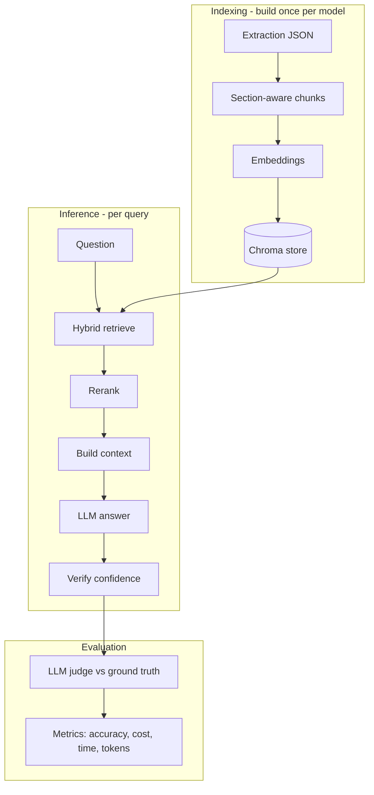

# Documentation

Detailed documentation for the **Metadata Enrichment** RAG system. If you are new,
start with the root [`README.md`](../README.md), then use these guides for depth.

## Contents

| Doc | Read it when you want to… |
|---|---|
| [architecture.md](architecture.md) | Understand the overall design, the two code roots, and how modules fit together |
| [pipeline.md](pipeline.md) | Follow a query through every RAG stage (chunk → embed → retrieve → rerank → context → LLM → verify) |
| [configuration.md](configuration.md) | Look up every `RagConfig` option and what it changes |
| [cli-reference.md](cli-reference.md) | Find the exact command and flags for any task |
| [webapp.md](webapp.md) | Run, understand, or modify the RAG Explorer web app |
| [benchmarking.md](benchmarking.md) | Run the evaluation and benchmarking suites |
| [data.md](data.md) | Understand the data folders and file formats |
| [troubleshooting.md](troubleshooting.md) | Fix a specific error or unexpected behaviour |

## The 30-second mental model

- **Indexing** is done once per (embedding model × chunk strategy) and cached in
  `chroma_store/`. Reusing the same settings never re-embeds.
- **Inference** answers a question against the built store.
- **Evaluation / benchmarking** compares answers to ground truth and sweeps
  components (embeddings, reranker, LLMs, embedding dimensions).

Everything is configured from [`rag/config.py`](../rag/config.py) and invoked from
the repository root as `python -m rag.<...>`.
