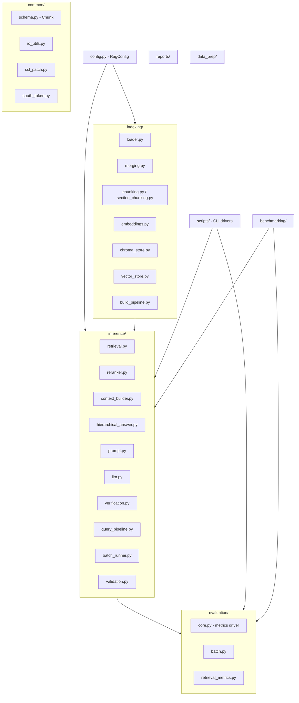
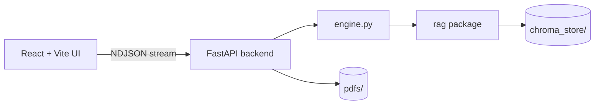

# Architecture

## Two code roots

All Python code lives in exactly two packages:

| Package | Responsibility |
|---|---|
| [`rag/`](../rag/) | The RAG pipeline and every offline tool: indexing, inference, evaluation, benchmarking, query generation, reports, and data prep. |
| [`webapp/`](../webapp/) | An interactive web application (FastAPI backend + React frontend) that wraps the `rag` package. |

Everything else at the repo root is **data** (see [data.md](data.md)) — never code.

Both packages are invoked from the repository root, so the repo root is always on
`sys.path` and package-qualified imports (`from rag...`, `import webapp...`) resolve.

## Module map (`rag/`)

### `rag/common/`
Shared primitives: the `Chunk` dataclass (`schema.py`), chunk JSONL IO
(`io_utils.py`), token/auth helpers (`token_utils.py`), the corporate SSL /
HuggingFace patch that must run before `transformers` imports (`ssl_patch.py`),
and the internal auth-token helper (`sauth_token.py`, git-ignored).

### `rag/indexing/` — build the searchable store
`loader.py` flattens Datalab extraction JSON into blocks; `merging.py` and
`section_chunking.py` group blocks into hierarchy-aware chunks; `embeddings.py`
(`EmbeddingBackend`) turns chunks into vectors; `chroma_store.py` persists them
in Chroma (embed-once); `vector_store.py` is the legacy in-memory FAISS + BM25
store. `build_pipeline.py` orchestrates the whole build.

### `rag/inference/` — answer a question
`retrieval.py` does dense/hybrid retrieval with metadata filters; `reranker.py`
applies a cross-encoder; `context_builder.py` assembles chunk / full-page /
hierarchical context; `hierarchical_answer.py` escalates to ancestor sections
until the LLM can answer; `prompt.py` holds the templates; `llm.py` is the LLM
client; `verification.py` runs the Chain-of-Verification confidence pass;
`query_pipeline.py` ties it together for a single query; `batch_runner.py` runs
the whole corpus in one process (loads models once); `validation.py` bridges to
the metrics driver.

### `rag/evaluation/` — measure quality
`core.py` is the pipeline-agnostic metrics machinery (timing, memory, tokens,
cost, accuracy) and the `run_evaluation` driver. `batch.py` is the legacy
subprocess-per-document driver. `retrieval_metrics.py` computes MTEB-style
retrieval metrics (MRR, Hit@k, Recall@k, nDCG@k, MAP) against the gold set.

### `rag/scripts/` — CLI drivers
Thin command-line front-ends for offline tasks (gold-set building, retrieval
scoring, Matryoshka study, chunking tuning, baselines, live validation). Run as
`python -m rag.scripts.<name>`.

### `rag/benchmarking/`, `rag/reports/`, `rag/data_prep/`, `rag/query_generation/`
Component benchmarks (embeddings/reranker/LLMs/Matryoshka), Word/Markdown report
generators, model download & PDF↔JSON linking, and schema-driven query synthesis.

## Web app (`webapp/`)

The backend (`webapp/backend/`) exposes document discovery, embed-once build, a
staged query stream (retrieve → rerank → LLM → verify → highlight), enrichment,
and gold-set review. It imports the `rag` package directly, so the web app and
the CLI always share the same pipeline behaviour. See [webapp.md](webapp.md).

## Key design decisions

- **One config object.** `RagConfig` in `config.py` is the single source of truth;
  stage modules read from it. CLI flags and env vars override it.
- **Embed-once.** Each (embedding model × chunk strategy) gets its own Chroma
  collection (`embedding_slug__chunk_strategy`), so switching models never
  overwrites or silently reuses another model's vectors.
- **Swap points.** Embedding model, vector DB, reranker, prompt, and LLM each live
  in a single file so a component can be replaced in isolation.
- **Shared engine.** CLI, batch runner, benchmarks, and web app all call the same
  `rag` functions, so results are consistent across entry points.
