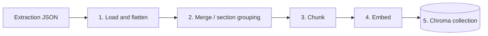
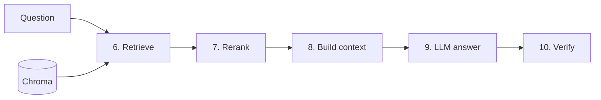

# The RAG pipeline, stage by stage

This walks a document and a question through the whole system. Every stage is
controlled by [`rag/config.py`](../rag/config.py); the relevant option is noted.

## Indexing (build once per model)

### 1. Load (`indexing/loader.py`)
Reads a Datalab extraction JSON (`datalab-output/datalab-output-<id>.pdf.json`)
and flattens it into text blocks with page numbers and a `section_hierarchy`.

### 2. Merge (`indexing/merging.py`)
Groups blocks by their leaf section and merges content across page breaks so a
section split over several pages becomes one coherent unit.
Config: `merge_sections`, `merge_across_pages`.

### 3. Chunk (`indexing/chunking.py`, `indexing/section_chunking.py`)
- `chunk_strategy="section"` (default): hierarchy-aware. Each chunk is a leaf
  section prefixed with its parent breadcrumb; oversize sections are split.
- `chunk_strategy="legacy"`: sliding window of `chunk_size` chars with `overlap`.

Config: `chunk_strategy`, `chunk_size`, `overlap`.

### 4. Embed (`indexing/embeddings.py`)
`EmbeddingBackend` turns chunk text into vectors. Backends:

| `embedding_model` | Backend |
|---|---|
| `openai` (default) | OpenAI-compatible `text-embedding-3-small/large` (SLB deployment) |
| `jina` | Local Jina v3 snapshot (`./jina-v3`) |
| `jina-api` | Hosted Jina v3 server with late chunking |
| `minilm` | `all-MiniLM-L6-v2` (sentence-transformers) |
| `tfidf` | TF-IDF fallback (no heavy deps) |
| any HF id | Loaded via sentence-transformers |

Config: `embedding_model`, `openai_embedding_model`,
`openai_embedding_dimensions` (Matryoshka truncation), `jina_api_*`.

### 5. Store (`indexing/chroma_store.py`)
Vectors are written to a persistent Chroma collection named
`<embedding_slug>__<chunk_strategy>` under `chroma_store/`. This is **embed-once**:
reusing the same model + strategy serves precomputed vectors straight from disk.
(`vector_backend="faiss"` uses the legacy in-memory FAISS index instead.)

Config: `vector_backend`, `chroma_dir`, `index_dir`.

## Inference (per query)

### 6. Retrieve (`inference/retrieval.py`)
- `retrieval_mode="dense"`: vector similarity only.
- `retrieval_mode="hybrid"`: blends dense + BM25 with
  `score = alpha*dense + (1-alpha)*bm25`. `hybrid_alpha=0` is pure BM25, `1` is
  pure dense.

Returns the top `top_k` chunks. Config: `retrieval_mode`, `hybrid_alpha`, `top_k`.

### 7. Rerank (`inference/reranker.py`)
A cross-encoder re-scores the retrieved candidates and keeps the best
`rerank_top_k`. Disable with `use_reranker=False`.
Config: `use_reranker`, `reranker_model`, `rerank_top_k`.

### 8. Build context (`inference/context_builder.py`)
| `context_mode` | Behaviour |
|---|---|
| `chunk` | Send only the matched chunk texts |
| `full_page` | Expand each matched chunk to its whole page |
| `hierarchical` (default) | Start from matched chunks and add ancestor sections on demand, re-prompting until the LLM can answer (see `hierarchical_answer.py`) |

Config: `context_mode`, `hierarchical_max_depth`, `save_pages_sent_to_llm`.

### 9. LLM answer (`inference/llm.py`, `inference/prompt.py`)
The context and question are formatted by `prompt.py` and sent to the LLM.
Config: `llm_model`, `llm_temperature`, `llm_base_url`, `partition_id`
(override via `LLM_MODEL`, `LLM_BASE_URL`, `SLB_PARTITION_ID`).

### 10. Verify (`inference/verification.py`)
A Chain-of-Verification (CoVe) pass corroborates the answer indirectly (retrieves
related facts and checks domain rules) and outputs a 0–1 confidence score. The
answer itself is never changed (except in enrichment, where a low-confidence
answer may be corrected and re-verified up to `max_verify_rounds`).
Config: `verify_enabled`, `verify_num_questions`, `verify_fresh_retrieval`,
`max_verify_rounds`.

## Evaluation

The LLM judge in `evaluation/core.py` compares each answer to the ground-truth
value with domain-aware tolerances (dates ±1 day, coordinate conversion,
formatting/synonyms). It records per-step time, peak memory, token usage, cost,
and accuracy. See [benchmarking.md](benchmarking.md).

## Where to change each component

| To change… | Edit… | or pass CLI flag |
|---|---|---|
| Embedding model | `indexing/embeddings.py` | `--embedding-model` |
| Vector DB | `indexing/vector_store.py` / `chroma_store.py` | — |
| Reranker | `inference/reranker.py` | `--reranker-model` |
| Prompt | `inference/prompt.py` | — |
| LLM | `inference/llm.py` | `--llm-model` |
| Any hyperparameter | `config.py` | see [cli-reference.md](cli-reference.md) |
